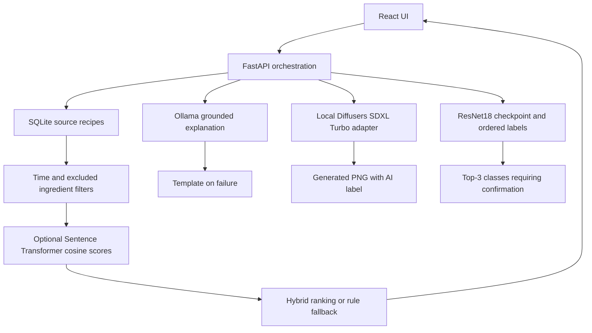

# AI architecture v0.2

## Request paths

## Configuration

Base mode needs only `backend/requirements.lock.txt`. Optional inference dependencies are in `backend/requirements-ai.txt`; they are not yet validated as a locked GPU environment. Install them into a separate environment suitable for your hardware. CPU is the default; set `AI_DEVICE=cuda` or `mps` only if your installed runtime supports it. CNN currently runs on CPU.

Export environment variables before starting the backend. Copy `.env.example` to the ignored root `.env`; the API loads it on startup. Missing configuration disables each provider independently. `/api/health` distinguishes `not_configured` from `configured_unverified`; configuration is not a readiness check.

### Encoder Transformer

For Ollama embeddings, set `OLLAMA_EMBED_MODEL=nomic-embed-text:latest`; the adapter calls `/api/embed` with document/query prefixes, normalizes vectors, and caches documents. This takes precedence over SentenceTransformer when both are set. This English-oriented model is a functional local baseline, not validated Chinese retrieval.

Alternatively set `EMBEDDING_MODEL` to a local SentenceTransformer directory or a Hugging Face ID. For the Chinese interface, start by evaluating `sentence-transformers/paraphrase-multilingual-MiniLM-L12-v2`. Initial request may download weights. Model loading is lazy. Normalized document embeddings are cached in process for up to eight corpus snapshots; changing records changes the cache key. Query and recipe vectors use dot product/cosine, clamped to [0,1].

Hard filters and the requirement of at least one exact normalized ingredient match are applied before encoding. This is semantic reranking of eligible candidates, not unrestricted semantic recall. Hybrid weights: ingredient .40, time .25, cuisine .20, semantic .15. If encoding fails, use original .60/.20/.20 rule weights and report the actual ranking method. No model metrics have been measured.

### LLM

Start your own Ollama service, provision a compatible model, then export `OLLAMA_MODEL` and optionally `OLLAMA_BASE_URL` (default loopback port 11434). No model is downloaded by this adapter. It calls `/api/chat` with streaming disabled, a 5-second connect and 60-second HTTP operation timeout, a bounded token budget, and the selected recipe as data. Output is labeled as LLM-generated and cites the source record ID. Prompt grounding reduces unsupported statements but does not guarantee factual consistency; no automated factual verifier exists. Failures return a labeled template and preserve original steps.

### Diffusion

Set `DIFFUSION_MODEL` to a compatible SDXL Turbo pipeline, for example `stabilityai/sdxl-turbo`, only after verifying license and hardware. Parameters are configurable: `DIFFUSION_STEPS` (default 4), `DIFFUSION_GUIDANCE` (default 0), 512px. For SD 1.5 use 20 steps and guidance 7.5. CUDA uses float16; CPU/MPS use float32; MPS enables attention slicing. First call may download weights. Generation is synchronous, one request per process; concurrent requests return 503. Generated PNGs are saved under ignored `generated/`, served at `/generated/`, and explicitly labeled AI-generated in the UI.

`POST /api/image-jobs` creates a job in an ignored SQLite status database. A single-worker executor bounds local model concurrency; `GET /api/image-jobs/{job_id}` supports polling, and `DELETE` cancels work that has not started. Restarted queued/running records are marked failed instead of remaining stuck. An already-running Diffusion call cannot be interrupted safely, and there is no inference deadline, retention policy or multi-process queue coordination. Use this only for local development until those concerns are addressed.

### CNN

Set `CNN_CHECKPOINT` to a trusted ResNet18 state_dict with a classification head matching the ordered JSON string list at `CNN_LABELS_PATH`. Checkpoint loading uses `weights_only=True`; no random/ImageNet output is relabeled as Food-101. Preprocessing currently follows `ResNet18_Weights.DEFAULT.transforms()`; training must use compatible evaluation normalization/resize conventions. A five-class classifier head has now been trained from official Food-101 splits; see scripts/train_cnn.py and evaluation/REPORT.zh.md. The backbone remains frozen.

`POST /api/classify-food` takes a raw JPEG/PNG/WebP request body, limited to 5 MB and 16 megapixels. Top-3 softmax scores are not calibrated confidence guarantees. Response requires user category confirmation; the .6 low-confidence threshold is a heuristic. The photo-upload UI, title/category heuristic mapping and confirmed category retrieval are now implemented.

## Validation boundary

Automated tests exercise the rule/semantic switch, hard filtering, mocked Ollama success/timeouts, semantic loading failure, generated asset handling with a fake pipeline, and upload limits. Real inference, model training and measured evaluation have additionally been run on this local machine; reports are in evaluation/results. Contract tests alone still do not establish model quality. Provider failures are logged server-side without returning internal exception details.

## References

- SentenceTransformer API: https://www.sbert.net/docs/package_reference/sentence_transformer/model.html
- Ollama chat API: https://docs.ollama.com/api/chat
- Diffusers AutoPipeline: https://huggingface.co/docs/diffusers/main/tutorials/autopipeline
- Torchvision ResNet: https://github.com/pytorch/vision/blob/main/torchvision/models/resnet.py

Ollama requests use `keep_alive=0s` to release model memory after requests on a 16GB machine. Cached document vectors remain in the API process. Restart the API after changing configuration.

By default `DIFFUSION_UNLOAD_AFTER_GENERATION=1` clears cached pipeline weights after a job to free GPU memory for the LLM; set 0 only when sufficient memory is available. Local inference dependency versions are recorded in `backend/requirements-local-ai.lock.txt` for this Apple silicon/Python 3.13 environment; it is separate from the base CI dependency set.

LLM responses now use an Ollama JSON schema with recipe_id and explanation, enforce source ID equality and a short text limit, and request no amounts/units or rewritten steps. This is output contract validation, not a factual verifier; see before/after provider smoke reports.
