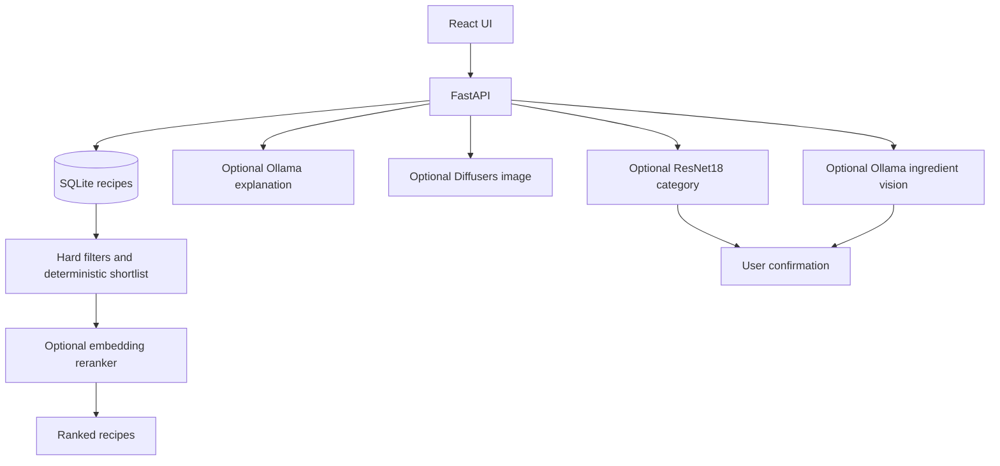

# AI architecture v0.4 — current source and environment

Status date: 2026-11-22.

## Request paths



Recommendation remains available without AI providers. Provider errors do not replace the source recipe record.

## Verified Windows environment

The current training interpreter is:

```text
D:\CondaEnvs\myenv\python.exe
```

Verified on Windows 11 with Python 3.14.7, PyTorch 2.14.1+cu132, CUDA 13.2 runtime support and an NVIDIA GeForce RTX 4080 Laptop GPU with approximately 12 GB VRAM. Sentence Transformers, Transformers, Datasets, Accelerate, PEFT, TRL, Diffusers, scikit-learn and TensorBoard import successfully.

New Hugging Face, Datasets and Torch caches are directed to `D:\CondaEnvs\myenv\cache` by the training scripts. The official Diffusers v0.42.0 source example is present under `D:\CondaEnvs\myenv\src\diffusers`.

## Current provider status

The repository currently has no root `.env`, so every optional provider is unconfigured by default.

| Provider | Environment configuration | Current local asset state |
| --- | --- | --- |
| Sentence Transformer | `EMBEDDING_MODEL`, `AI_DEVICE=cuda` | No model selected/downloaded by this project |
| Ollama embeddings | `OLLAMA_EMBED_MODEL`, `OLLAMA_BASE_URL` | No model configured |
| Ollama LLM | `OLLAMA_MODEL` | No model configured |
| Diffusers | `DIFFUSION_MODEL`, steps/guidance/device | No base model configured |
| ResNet18 CNN | `CNN_CHECKPOINT`, `CNN_LABELS_PATH` | Labels present; checkpoint absent |
| Ollama ingredient vision | `OLLAMA_VISION_MODEL` | No model configured |

## Model boundaries

### Embedding reranker

Rule filters run first. At most 128 eligible candidates are encoded. Sentence Transformer vectors or Ollama `/api/embed` vectors are normalized and used only for reranking. Failure returns to the deterministic baseline.

### LLM

The Ollama adapter requests a short JSON object containing the selected `recipe_id` and an explanation. It constrains output shape and source linkage, but it is not a factual verifier. Failure returns a clearly labeled template based on the stored recipe.

### Diffusion

The Diffusers adapter produces a separate AI-labeled concept image. CUDA uses FP16. Image jobs are stored in a local ignored SQLite database and processed by one in-process worker. Queued jobs can be cancelled; already-running inference cannot be safely interrupted. There is no production queue, retention policy or multi-process coordination.

### ResNet18 CNN

The classifier expects a trusted ResNet18 state dictionary whose final layer matches the ordered labels file. The supported labels are `dumplings`, `fried_rice`, `omelette`, `pizza` and `ramen`. Softmax values are not calibrated confidence guarantees, so the UI requires confirmation.

A committed historical report records a frozen ImageNet backbone plus a trained five-class head and 91.60% Top-1 accuracy on 1,250 held-out Food-101 images. That run used MPS in a previous environment. Its checkpoint and raw images are not present in the current checkout, so the result is evidence of a past run, not a currently runnable model.

### Ingredient-photo vision

One to three validated images are resized and sent to a configured Ollama vision model. Its text is conservatively mapped to a fixed ingredient vocabulary. Suggestions are marked uncertain and require user correction; the feature cannot establish freshness, food safety, allergens or quantities.

## Training entry points

- `scripts/train_cnn.py`: five-class Food-101 transfer learning; now selects CUDA when available.
- `scripts/train_retriever.py`: Sentence Transformer training from query/positive/optional-negative JSONL.
- `scripts/train_llm_lora.py`: chat-style causal-LM LoRA.
- `scripts/train_vlm_lora.py`: conversational image/text VLM LoRA.
- `scripts/train-diffusion-lora.ps1`: launcher for the official Diffusers LoRA example.

The scripts and environment are ready, but no new Windows training run has been performed because the required datasets and model weights have not been downloaded.

## Validation boundary

The backend test suite currently passes 46 tests. Training scripts compile and expose their command-line interfaces, CUDA is detected, and the official Diffusers example loads. These checks establish software readiness, not model quality. Historical files in `evaluation/results` must retain their recorded hardware, data and limitations when cited.
