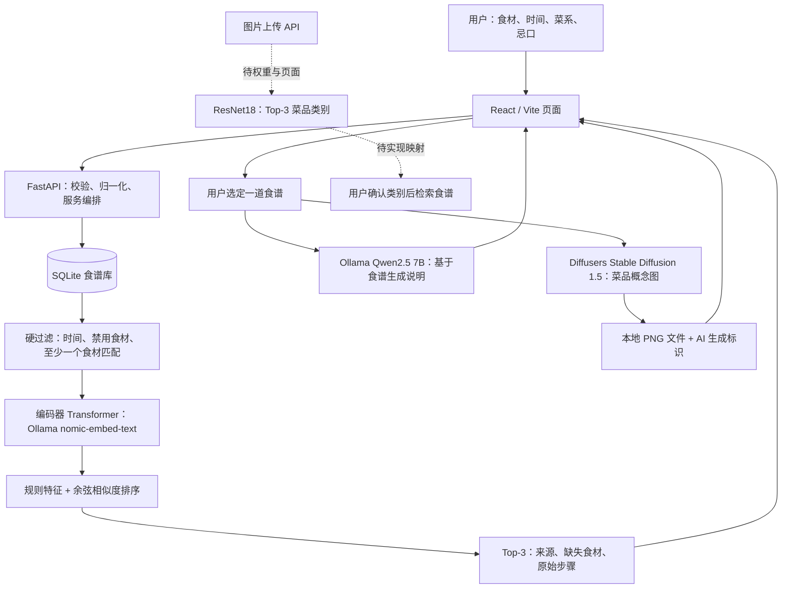

# 整体架构

采用模块化单体架构：一个 React 前端、一个 FastAPI 后端、本地 SQLite 和可替换的 AI 模型适配器。当前无需微服务或向量数据库。

## 模块分工

| 模块 | 责任 | 当前实现 |
| --- | --- | --- |
| React | 收集条件、展示结果、说明和生成图片 | 已实现；照片上传页面待补 |
| FastAPI | 输入校验、错误处理、串联数据与 AI | 已实现 |
| SQLite | 保存食谱、食材、步骤、来源 | 六条演示记录，真实数据待导入 |
| 推荐服务 | 时间与忌口硬过滤、食材覆盖率与语义排序 | 已实现；语义失败回退规则 |
| 编码器 Transformer | 将查询和候选转换为向量 | 本机使用已有 nomic-embed-text |
| LLM | 解释选定食谱，不替换原始数据 | 本机使用已有 Qwen2.5 7B |
| Diffusion | 根据选定食谱生成独立概念图 | 本机复用 SD 1.5 缓存、MPS |
| CNN | 图片类别预测，用户确认后再检索 | 推理适配器已有，食物分类权重缺失 |

推荐链路不等待 LLM 或图像生成。它们在用户选定食谱后分别触发。语义服务失败时回退规则；LLM 失败时返回模板；生成失败保留原始食谱。

## 数据与模型边界

食谱库是步骤和食材的来源；向量模型只参与候选排序；LLM 文字需标注为生成说明；Diffusion 图片是概念图。CNN 分类不等于识别完整食材清单。当前语义层是过滤后重排，尚未实现全库向量召回。

CNN、编码器 Transformer、LLM、Diffusion 对应四个模型模块；课程如何计入主题需以课程认定为准。没有自行训练或评估结果，不能宣称模型准确率。

## 本地运行

1. `ollama serve` 启动本地模型服务（若已有服务则复用）。
2. 根目录 `.env` 配置模型与本机缓存路径；文件不会提交 Git。
3. `sh scripts/start-backend.sh` 启动后端，读取 `.env`。
4. 在 `frontend` 中运行 `npm run dev`，打开 http://127.0.0.1:5173。

配置及限制详见 [AI 架构](ai-architecture.md)。图像生成目前为同步请求，不具备持久化任务队列和取消机制；在本机按需触发单张生成。
