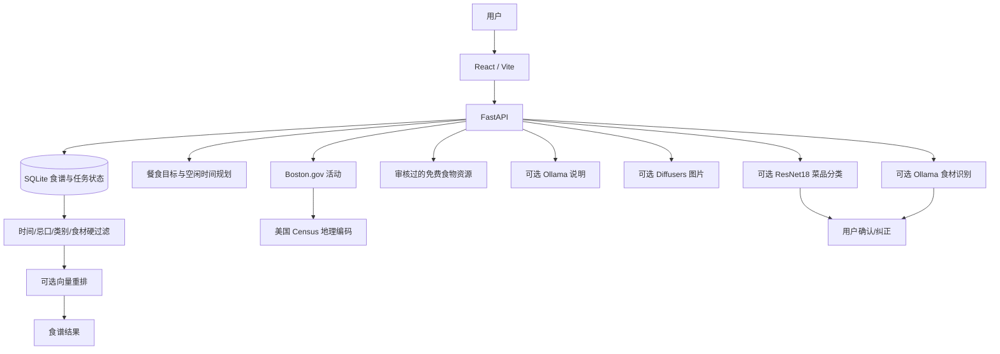

# 当前系统架构

状态日期：2026-11-22。

项目采用模块化单体架构：React/Vite 前端、FastAPI 后端、本地 SQLite、可选 AI 适配器和少量公开信息源。当前不需要微服务或向量数据库。

## 模块分工

| 模块 | 责任 | 当前状态 |
| --- | --- | --- |
| React | 搜索、照片确认、餐食计划、活动和食物资源展示 | 源码已实现 |
| FastAPI | 校验、编排、回退、外部信息访问 | 源码已实现 |
| SQLite | 食谱与图片任务状态 | 当前文件不存在，启动时创建 |
| 推荐服务 | 硬过滤、规则排序、可选语义重排 | 已实现 |
| 餐食计划 | 目标、已有食材、空闲时间和季节提示 | 已实现；属于启发式，不是医疗建议 |
| 公共信息 | Boston.gov RSS、Census 坐标、审核资源登记表 | 已实现；实时刷新依赖网络 |
| 编码器 | 查询和候选向量化 | 适配器存在，当前未配置模型 |
| LLM | 对选定食谱生成受约束说明 | 适配器存在，当前未配置 Ollama |
| Diffusion | 生成独立且标记为 AI 的概念图 | 适配器存在，当前未配置基础模型 |
| CNN | 五类菜品预测 | 标签存在，checkpoint 缺失 |
| VLM | 图片中的可见食材建议 | 适配器存在，当前未配置模型 |

## 数据流与边界

食谱记录是食材、步骤、时间和来源的权威数据。向量模型只对规则筛选后的候选进行重排；LLM 只能生成补充说明；Diffusion 图片是概念图；CNN 只预测五个菜品类别；VLM 输出必须由用户确认。

排除食材使用有限的字符串和家族规则，不能保证过敏安全。餐食目标分数、季节提示和运动文字是透明的一般性启发式，不计算临床营养需求或运动热量。Boston 资源只表示发布来源和时间表，不表示实时库存、开放状态或食品安全。

## 当前运行状态

当前项目目录没有真实数据文件、运行数据库、`.env` 或 CNN checkpoint。启动后会建立 SQLite 并写入六条明确标记的 demo 食谱。因此：

- 基础 UI、API 和确定性推荐可以演示。
- 真实食谱搜索和真实数据餐食计划需要先导入 Food.com。
- AI 功能需要在 `.env` 中配置实际模型或服务。
- CNN 必须先生成/取得与标签匹配的可信 checkpoint。
- 历史评估文件不能视为当前 Windows 环境已经复现。

## 本机环境

训练和可选推理依赖已安装在 `D:\CondaEnvs\myenv`。RTX 4080 Laptop GPU 和 CUDA 已被 PyTorch 检测。数据集下载、处理和训练步骤见 `windows-training.zh.md`；基础启动方式见 `local-setup.zh.md`。
