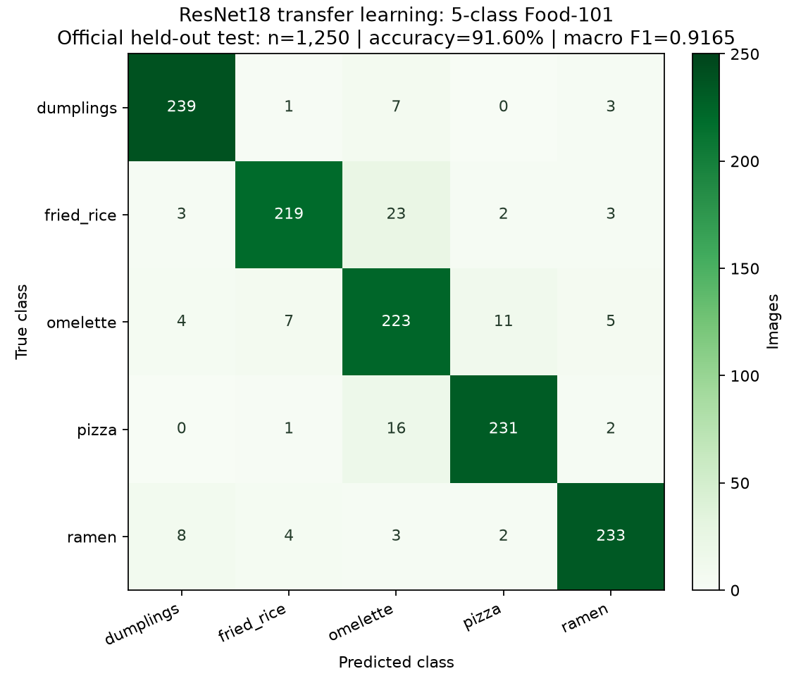
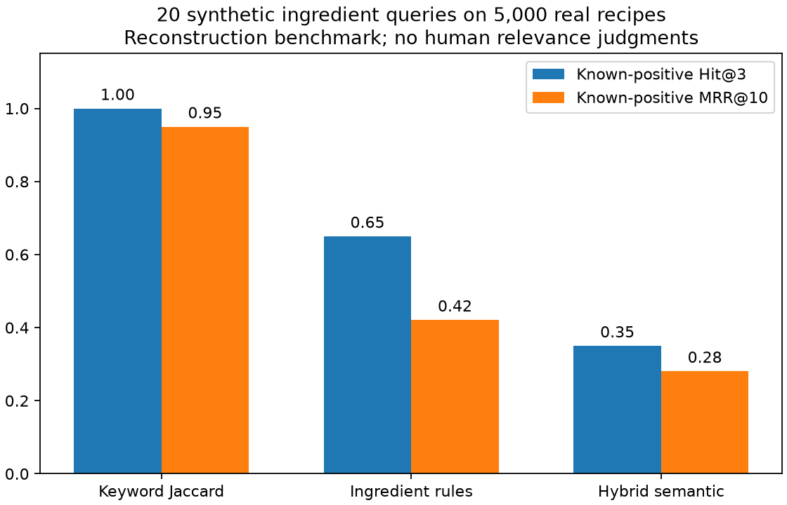

# 模型评估报告（2026-11-17）

所有数值来自本机脚本实际执行；不把目标值、接口测试或预训练模型描述当成模型质量结果。

## CNN：五类迁移学习

- 类别顺序：dumplings, fried_rice, omelette, pizza, ramen。
- 来源：Food-101 官方压缩包，SHA256 与来源元数据一致。
- 每类：官方训练图片 750 张中，固定 seed=42 分为训练 600 / 验证 150；官方测试 250 张独立保留。总计训练 3,000 / 验证 750 / 测试 1,250，ID 无交集。
- ImageNet 预训练 ResNet18 主干冻结，仅训练新的 512→5 线性分类头；60 个 epoch，按验证集 Macro-F1 选模型，未按测试集调参。不是从零训练 CNN。
- 本机特征提取使用 MPS，训练分类头使用 CPU；训练及特征提取实测约 36.17 秒（包括首次权重加载，不是统一硬件性能基准）。

| 独立官方测试集指标 | 实测 |
| --- | ---: |
| Top-1 Accuracy | 91.60% |
| Top-3 Accuracy | 98.96% |
| Macro-F1 | 0.9165 |
| 均衡五类多数类别基线 | 20.00% |

这是限定五类的 closed-set 测试，不是 Food-101 全部 101 类结果，也不是任意照片准确率。未知菜品仍会被强制分配到支持类，概率没有校准。页面明确要求用户确认或纠正类别。

## 推荐：关键词 / 规则 / 语义对照

固定原始 5,000 条真实食谱语料；seed=2026，抽取 20 条来源食谱，每条随机取三个食材名作查询，来源食谱的时间作上限，将该来源 ID 记为一个“已知相关”项。其他相关食谱没有人工标注，因此 **不把这些指标称为通用 Recall@K、用户满意度或人工相关性准确率**。

| 方法 | Known-positive Hit@3 | Hit@10 | MRR@10 |
| --- | ---: | ---: | ---: |
| keyword_jaccard | 100.00% | 100.00% | 0.9500 |
| ingredient_rules_v1 | 65.00% | 75.00% | 0.4210 |
| hybrid_semantic_v1 | 35.00% | 70.00% | 0.2808 |

这组来源重建查询天然偏向食材匹配，关键词基线明显更好；当前语义加权未展示收益。API 在硬过滤后先选 128 条规则候选再语义重排，关键词基线扫描所有合格候选，候选窗口也是比较中的一个限制。不能据此宣称 Transformer 提升了相关性，下一步应收集独立人工查询与标注并在开发集调权、保留最终测试集。

20 条查询中规则与语义结果均未违反时间上限，语义没有发生回退；禁用食材与类别过滤另由自动化测试验证。具体查询、排名、耗时和实际使用方法保存在 `results/retrieval_metrics.json`。

## LLM 与 Diffusion

最新结构化说明复测：3 条真实食谱，实际 LLM 响应成功率 100%，平均耗时 9.90 秒。三条来源 ID 均匹配。该检查只验证调用、结构与来源关联，不等于事实一致性准确率。

初次抽查发现模型会把缺少单位的数量解释为“份”等，因此输出收紧为单段说明、JSON schema 和来源 ID 校验，禁止补写单位、数量和新步骤。初次与修改后响应均保留在 `provider_smoke_initial.json` 和 `provider_smoke.json`；新响应仍可能包含泛化建议，提示约束不能代替事实验证。独立人工事实一致性评分尚未完成。

Diffusion 保留两次真实生成的技术数据与编码助手视觉检查记录：同一道演示炒饭，首次主要表现煎蛋/番茄，英文描述后能看出米饭但添加额外蔬菜与煎蛋。两次文件生成均成功，约 90.53 秒与 32.55 秒。它们是修改提示前后的开发样例，不是随机、独立或代表性图像质量基准。不能把接口成功率说成菜品还原准确率。

## 完整系统流程

`results/photo_flow_smoke.json` 记录五个类别各一张按 ID 排序选取的官方测试图，经真实 HTTP 上传、输出 Top-3、显式确认已知类别，再检索真实食谱。确认使用已知标签模拟用户纠正，不是“直接接受预测即成功”。这五个样例只检验集成流程；分类准确率以完整 1,250 张测试结果为准。

类别映射仍是标题/来源分类启发式，已排除明显甜点、蘸酱、披萨面皮、单独拉面汤底等词义误匹配；不等同于逐条人工审核或原数据集图片配对。需要进一步收集映射相关性标注。

## 可复现资料

- `scripts/train_cnn.py`：训练与官方测试，输出 checkpoint SHA256、版本、混淆矩阵和逐类指标。
- `scripts/evaluate_retrieval.py`：固定 5,000 条基线对照。
- `scripts/evaluate_providers.py`：本地提供方烟测，不是事实自动评分器。
- `scripts/smoke_photo_flow.py`：真实上传→确认→检索。
- `scripts/plot_evaluation.py`：从 JSON 指标重建图表。
- 数据来源与许可见 `data_metadata/datasets.json`；训练权重只保存在本地忽略目录。

## 多图食材建议与免费供餐：新增集成范围

新增 LLaVA 7B 本地预训练视觉模型，逐张分析 1–3 张食材照片，再以有限英文词表保守提取候选食材；不是对原 CNN 增加了食材类别，也不是已经训练好的食材目标检测器。所有候选默认未勾选、标为不确定，需人工确认/纠正才用于食谱搜索。不能沿用五类 CNN 的 91.60% 来描述这个入口。

两张来自 Wikimedia Commons 的真实照片用于开发烟测，来源和许可在 `data_metadata/ingredient_photo_sources.json`。最终真实 HTTP 结果见 `results/food_and_photos_smoke.json`，包括预期可见食材、实际建议、漏项、额外项和手动确认列表。开发过程中调整了提示与解析，故不能把这两张当独立测试集，不能声称任意食材识别准确率已验证。

免费食物地图改为审核过的供餐项目与市政府活动的明确免费食物证据；“免费入场”不会自动成为“免费食物”。初始目录是两个地点的四项服务，不是全波士顿搜索。源页面检查与定期刷新不代表实时库存、餐食热量、领取成功或假日营业保证。
